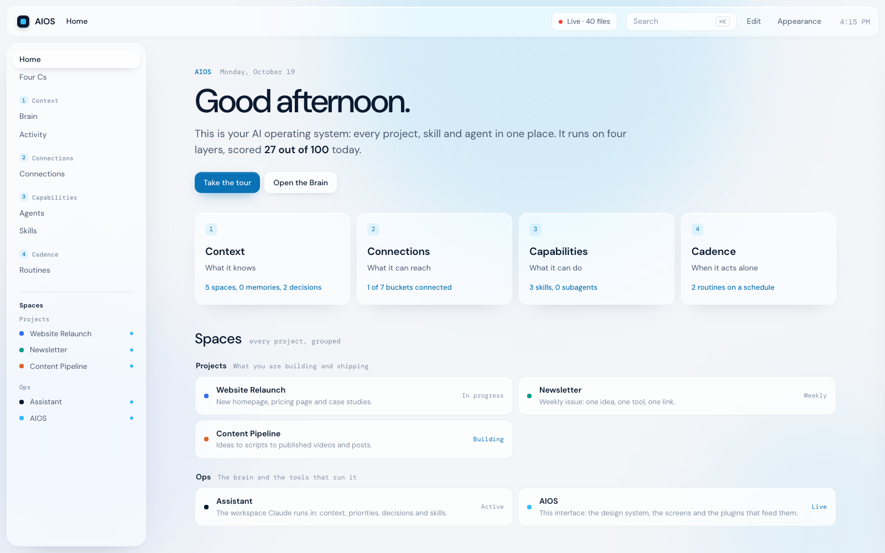
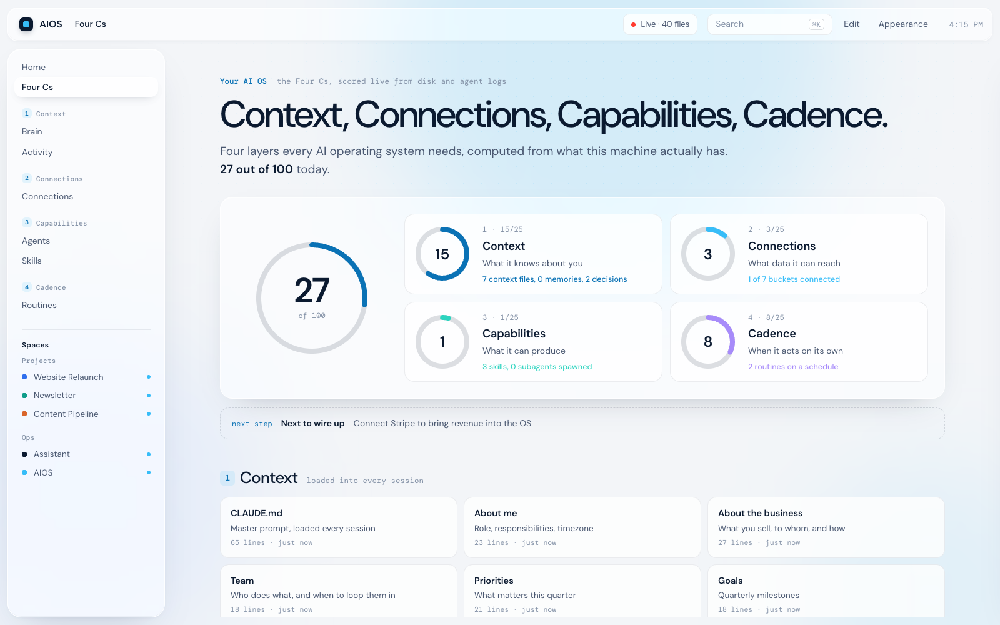
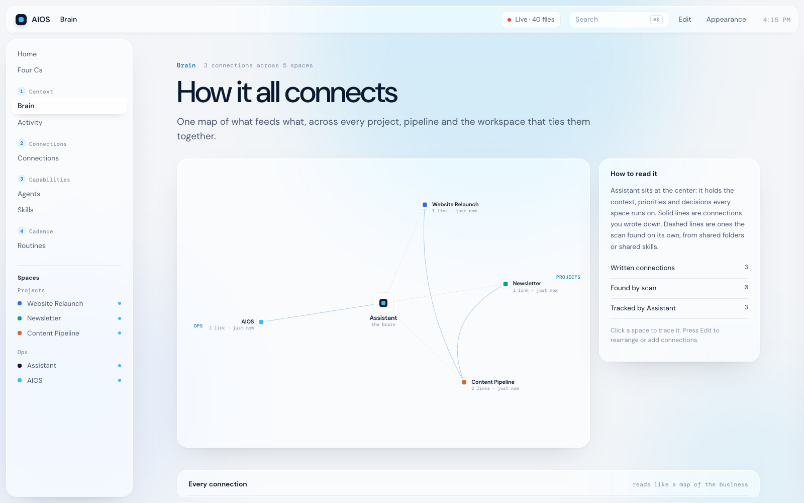
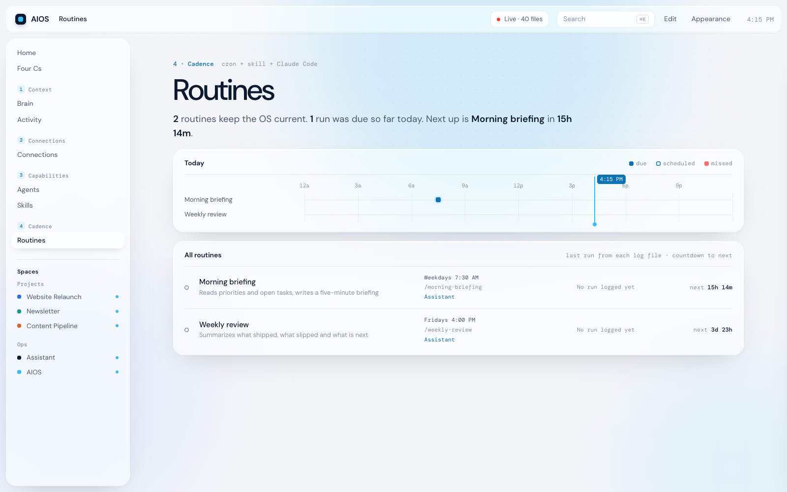

# AI OS

Your AI operating system already works. It lives in Claude Code sessions, `CLAUDE.md` files, skills, project folders and tools, but you can't see it. This repo gives you two things:

1. **A workspace** for Claude to run your work from: context, priorities, decisions, projects and skills, in one folder.
2. **AIOS**, a local interface that shows the whole system in one place: every project, what changed today, what your agents are doing, how everything connects, and what runs on a schedule.

AIOS is read-only. It never moves or changes your files.



## Quick start

You need [Node.js](https://nodejs.org) 20 or newer. Nothing else to install.

```bash
git clone https://github.com/aidan785/ai-os.git
cd ai-os
node server.mjs
```

Open **http://localhost:4747**. It starts on the example workspace in `workspace/`. On a Mac you can also double-click `start.command`.

Then point it at your own work: follow [docs/setup.md](docs/setup.md), or open Claude Code in this folder and say:

```
Read docs/setup.md and docs/configuration.md, look at my project folders, and set up aios.config.json for me.
```

## What you get

**Four Cs.** Every AI OS has four layers: **Context** (what it knows), **Connections** (what it can reach), **Capabilities** (what it can do) and **Cadence** (when it acts on its own). AIOS scores yours out of 100 from what is actually on disk and in your agent logs, and tells you what to wire up next. [More on the Four Cs](docs/four-cs.md).



**Brain.** One map of how your projects feed each other. Solid lines are connections you write down; dashed lines are ones AIOS finds on its own from shared folders and skills.



**Agents.** Reads your Claude Code logs (`~/.claude/projects`) and shows every session, the subagents it spawned grouped by role, which tools they called, and a live feed of tool calls from the last six hours.

**Routines.** Every scheduled skill, today's timeline, when each one last ran (from its log file) and a countdown to the next run.



**And:** a page per project with recent files, 14-day activity, connections and skills; a live activity feed; ⌘K search across everything; a preview drawer that renders Markdown, HTML, images and video; edit mode (rename, recolor, reorder, hide, add spaces); light and dark themes; and an Obsidian mirror of the whole system in `wiki/`.

Optional, off by default: **Ask AIOS** (a read-only Claude agent that answers questions about your projects) and a **ClickUp crew** (an orchestrator and two scouts that read your open tasks and priorities, then write a briefing). Both run `claude -p` with write tools blocked.

## The design

The look comes from two files Claude reads before any design work: [`DESIGN.md`](DESIGN.md) (tokens, type, layout, surfaces, motion, a checklist) and [`PRODUCT.md`](PRODUCT.md) (who it is for and what it must never look like). [`design/`](design/) explains how they were written, with the prompts and blank templates to make your own.

## Set it up in five steps

1. **Point it at your project folders, read-only.** Each project becomes a space in `aios.config.json`.
2. **Read your Claude Code logs to find every agent.** Automatic.
3. **Group everything by the Four Cs.** Fill in the workspace, list your tools and skills.
4. **Wire in your tools and put skills on a schedule.** MCP connectors, then a cron job per routine.
5. **Mirror it into Obsidian, then apply one design system.**

Each step is in [docs/setup.md](docs/setup.md).

## What's in the repo

| Path | What it is |
| --- | --- |
| `workspace/` | The assistant workspace template: `CLAUDE.md`, `context/`, decision log, projects, three starter skills |
| `server.mjs`, `agents.mjs`, `plugins/` | The local server: scans folders and logs, serves the UI. Zero dependencies |
| `public/` | The interface |
| `aios.config.example.json` | The example config. Your copy, `aios.config.json`, is gitignored |
| `DESIGN.md`, `PRODUCT.md`, `design/` | The design system, the product brief, and how to make your own |
| `docs/` | [Setup](docs/setup.md), [configuration](docs/configuration.md), [the Four Cs](docs/four-cs.md), [how it is structured](docs/structure.md) |
| `CLAUDE.md` | The guide Claude reads when you work on AIOS itself |

## Privacy

- Everything runs on your machine. The interface loads two Google Fonts and nothing else from the internet. Ask AIOS and the ClickUp crew, when you turn them on, run through your own Claude Code.
- It only listens on `127.0.0.1` and refuses requests from other websites.
- The `deny` list in your config hides matching files everywhere (`.env`, tokens, keys and invoices by default).
- It writes only to `data/` (your in-app edits) and `wiki/`. Both are gitignored, along with your config.
- The Agents view shows your session titles and subagent task descriptions. Check it before you share your screen.

## License

MIT. See [LICENSE](LICENSE).
